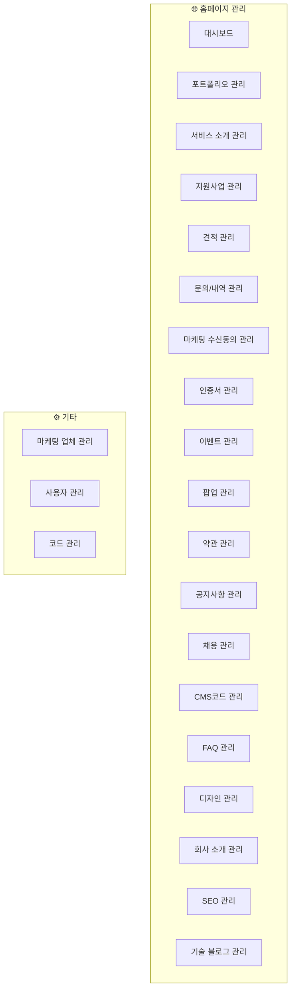

# 레피소드(Lepisode) 홈페이지 역설계 분석 (v2)

## 1. 원본 사이트 정보

| 항목 | 내용 |
|------|------|
| **URL** | https://lepisode.team (= lepisode.kr) |
| **업종** | IT/SaaS — 웹·앱 개발, AI 솔루션, IT 컨설팅 |
| **기술 스택** | Angular (SSR), SUIT 폰트 |
| **다국어** | 한국어 + 영어 (우리 프로젝트 기준) |

---

## 2. 관리자 메뉴 구조 (실제 사이드바 기반)



---

## 3. 전체 모듈 분류

### 🟢 핵심 모듈 (Phase 1 - 우선 구현)

| # | 모듈 | Shop 페이지 | Admin 기능 | 설명 |
|---|------|------------|-----------|------|
| 1 | **포트폴리오** | 목록 + 상세 | CRUD | 프로젝트 사례 |
| 2 | **서비스 소개** | 서비스 페이지 | CRUD | 제공 서비스 카드 |
| 3 | **회사 소개** | About 페이지 | CRUD | 비전, 연혁, 팀 |
| 4 | **기술 블로그** | 목록 + 상세 | CRUD | 기술 아티클 |
| 5 | **공지사항** | 목록 + 상세 | CRUD | 공지 |
| 6 | **FAQ** | FAQ 페이지 | CRUD | 자주 묻는 질문 |
| 7 | **문의/내역** | 문의 폼 | 목록 + 상태관리 | 프로젝트 의뢰 |
| 8 | **채용** | 채용 목록 | CRUD | 채용 공고 |

### 🟡 보조 모듈 (Phase 2)

| # | 모듈 | 설명 |
|---|------|------|
| 9 | **견적 관리** | 견적 요청/응답 관리 |
| 10 | **이벤트 관리** | 프로모션/이벤트 배너 |
| 11 | **팝업 관리** | 사이트 팝업 (공지, 이벤트) |
| 12 | **인증서 관리** | 기업 인증서/수상 내역 |
| 13 | **지원사업 관리** | 정부/기관 지원사업 |
| 14 | **약관 관리** | 이용약관, 개인정보처리방침 |
| 15 | **마케팅 수신동의** | 마케팅 동의 사용자 관리 |

### 🔵 시스템 모듈 (Phase 3)

| # | 모듈 | 설명 |
|---|------|------|
| 16 | **사용자 관리** | 관리자 계정 관리 |
| 17 | **SEO 관리** | 메타 태그, OG, sitemap |
| 18 | **디자인 관리** | 색상, 로고, 배너 이미지 |
| 19 | **CMS코드 관리** | 공통 코드 (카테고리 등) |
| 20 | **코드(Code)** | 시스템 코드 테이블 |
| 21 | **마케팅 업체** | 외부 마케팅 파트너 |
| 22 | **대시보드** | 통계/요약 |

---

## 4. DB 모델 설계 (Prisma)

### Phase 1 핵심 모델

```prisma
// ── 관리자 ──
model AdminUser {
  id        Int      @id @default(autoincrement())
  email     String   @unique
  password  String
  name      String
  role      Role     @default(ADMIN)
  createdAt DateTime @default(now())
  updatedAt DateTime @updatedAt
}

enum Role {
  SUPER_ADMIN
  ADMIN
}

// ── 포트폴리오 ──
model Portfolio {
  id           Int      @id @default(autoincrement())
  title        String
  titleEn      String?
  client       String?    // 클라이언트 회사
  category     String     // 웹, 앱, AI 등
  period       String?    // 개발 기간
  techStack    String?    // JSON or comma-separated
  thumbnailUrl String?
  images       String?    // JSON array of URLs
  description  String?    @db.Text
  descriptionEn String?   @db.Text
  published    Boolean    @default(false)
  sortOrder    Int        @default(0)
  createdAt    DateTime   @default(now())
  updatedAt    DateTime   @updatedAt
}

// ── 서비스 소개 ──
model Service {
  id           Int      @id @default(autoincrement())
  title        String
  titleEn      String?
  description  String?  @db.Text
  descriptionEn String? @db.Text
  icon         String?    // 아이콘 클래스 or SVG
  imageUrl     String?
  sortOrder    Int        @default(0)
  published    Boolean    @default(false)
  createdAt    DateTime   @default(now())
  updatedAt    DateTime   @updatedAt
}

// ── 회사 소개 ──
model CompanyInfo {
  id        Int      @id @default(autoincrement())
  key       String   @unique  // vision, mission, address, phone...
  value     String   @db.Text
  valueEn   String?  @db.Text
  updatedAt DateTime @updatedAt
}

model TeamMember {
  id             Int      @id @default(autoincrement())
  name           String
  nameEn         String?
  position       String
  positionEn     String?
  profileImageUrl String?
  bio            String?  @db.Text
  bioEn          String?  @db.Text
  sortOrder      Int      @default(0)
  createdAt      DateTime @default(now())
  updatedAt      DateTime @updatedAt
}

model CompanyHistory {
  id           Int      @id @default(autoincrement())
  year         Int
  month        Int?
  title        String
  titleEn      String?
  description  String?
  descriptionEn String?
  sortOrder    Int      @default(0)
}

// ── 기술 블로그 ──
model BlogPost {
  id           Int           @id @default(autoincrement())
  title        String
  titleEn      String?
  content      String        @db.Text
  contentEn    String?       @db.Text
  thumbnailUrl String?
  category     String?
  tags         String?       // comma-separated
  viewCount    Int           @default(0)
  published    Boolean       @default(false)
  createdAt    DateTime      @default(now())
  updatedAt    DateTime      @updatedAt
}

// ── 공지사항 ──
model Notice {
  id        Int      @id @default(autoincrement())
  title     String
  titleEn   String?
  content   String   @db.Text
  contentEn String?  @db.Text
  published Boolean  @default(false)
  isPinned  Boolean  @default(false)
  createdAt DateTime @default(now())
  updatedAt DateTime @updatedAt
}

// ── FAQ ──
model FaqCategory {
  id        Int      @id @default(autoincrement())
  name      String
  nameEn    String?
  sortOrder Int      @default(0)
  faqs      Faq[]
}

model Faq {
  id           Int         @id @default(autoincrement())
  question     String
  questionEn   String?
  answer       String      @db.Text
  answerEn     String?     @db.Text
  published    Boolean     @default(false)
  categoryId   Int
  category     FaqCategory @relation(fields: [categoryId], references: [id])
  createdAt    DateTime    @default(now())
  updatedAt    DateTime    @updatedAt
}

// ── 문의 ──
model Inquiry {
  id          Int           @id @default(autoincrement())
  name        String
  email       String
  phone       String?
  company     String?
  budget      String?       // 예산 범위
  projectType String?       // 웹, 앱, AI 등
  content     String        @db.Text
  status      InquiryStatus @default(PENDING)
  isRead      Boolean       @default(false)
  createdAt   DateTime      @default(now())
  updatedAt   DateTime      @updatedAt
}

enum InquiryStatus {
  PENDING
  IN_PROGRESS
  COMPLETED
  CANCELLED
}

// ── 채용 ──
model JobPosting {
  id            Int      @id @default(autoincrement())
  title         String
  titleEn       String?
  department    String?   // 부서
  type          String?   // 정규직, 계약직, 인턴
  description   String    @db.Text
  descriptionEn String?   @db.Text
  requirements  String?   @db.Text  // 자격요건
  benefits      String?   @db.Text  // 복지/혜택
  published     Boolean   @default(false)
  deadline      DateTime?
  createdAt     DateTime  @default(now())
  updatedAt     DateTime  @updatedAt
}
```

### Phase 2 보조 모델

```prisma
// ── 견적 ──
model Estimate {
  id          Int      @id @default(autoincrement())
  name        String
  email       String
  phone       String?
  company     String?
  projectType String?
  budget      String?
  deadline    String?
  description String   @db.Text
  status      String   @default("PENDING")
  createdAt   DateTime @default(now())
  updatedAt   DateTime @updatedAt
}

// ── 이벤트 ──
model Event {
  id          Int       @id @default(autoincrement())
  title       String
  titleEn     String?
  description String?   @db.Text
  imageUrl    String?
  linkUrl     String?
  startDate   DateTime?
  endDate     DateTime?
  published   Boolean   @default(false)
  createdAt   DateTime  @default(now())
  updatedAt   DateTime  @updatedAt
}

// ── 팝업 ──
model Popup {
  id          Int       @id @default(autoincrement())
  title       String
  imageUrl    String?
  linkUrl     String?
  startDate   DateTime?
  endDate     DateTime?
  position    String    @default("CENTER") // CENTER, BOTTOM, FULL
  published   Boolean   @default(false)
  createdAt   DateTime  @default(now())
  updatedAt   DateTime  @updatedAt
}

// ── 인증서 ──
model Certificate {
  id          Int      @id @default(autoincrement())
  title       String
  titleEn     String?
  issuer      String?   // 발급 기관
  issueDate   DateTime?
  imageUrl    String?
  sortOrder   Int       @default(0)
  createdAt   DateTime  @default(now())
}

// ── 지원사업 ──
model SupportProject {
  id          Int      @id @default(autoincrement())
  title       String
  titleEn     String?
  organization String? // 지원 기관
  period      String?
  description String?  @db.Text
  published   Boolean  @default(false)
  sortOrder   Int      @default(0)
  createdAt   DateTime @default(now())
  updatedAt   DateTime @updatedAt
}

// ── 약관 ──
model Terms {
  id        Int      @id @default(autoincrement())
  type      String   @unique // SERVICE, PRIVACY, MARKETING
  title     String
  titleEn   String?
  content   String   @db.Text
  contentEn String?  @db.Text
  updatedAt DateTime @updatedAt
}

// ── SEO ──
model SeoConfig {
  id          Int      @id @default(autoincrement())
  pagePath    String   @unique  // /, /about, /service...
  title       String?
  titleEn     String?
  description String?
  descriptionEn String?
  ogImageUrl  String?
  updatedAt   DateTime @updatedAt
}

// ── CMS 코드 ──
model CmsCode {
  id        Int      @id @default(autoincrement())
  group     String   // CATEGORY, TAG, etc.
  code      String
  label     String
  labelEn   String?
  sortOrder Int      @default(0)
}
```

---

## 5. 구현 순서

> [!IMPORTANT]
> Phase 1부터 순차 구현합니다. 각 모듈은 **API → Admin → Shop** 순서로.

### Phase 1: 기반 + 핵심 (Backend CRUD)
1. ✅ Nx workspace 생성 + Prisma + DB 연결
2. ✅ AdminUser + Auth (JWT)
3. 서비스 소개 CRUD
4. 포트폴리오 CRUD
5. 회사 소개 (CompanyInfo + TeamMember + CompanyHistory)
6. 기술 블로그 CRUD
7. 공지사항 CRUD
8. FAQ CRUD
9. 문의 CRUD
10. 채용 CRUD

### Phase 2: 보조 모듈
11. 견적 관리
12. 이벤트 관리
13. 팝업 관리
14. 인증서 관리
15. 지원사업 관리
16. 약관 관리

### Phase 3: 시스템
17. 사용자 관리
18. SEO 관리
19. CMS코드 관리
20. 대시보드 (통계)

---

## Open Questions

> [!NOTE]
> 구현 전 확인 필요:

1. **다국어**: URL 경로 기반 (`/en/about`) vs 쿠키/로컬스토리지 기반?
2. **블로그 에디터**: 리치 텍스트 (Quill/TipTap) 사용?
3. **이미지 저장소**: Supabase Storage 계속 사용?
4. **견적 vs 문의**: 별도 모듈 or 통합? (현재 별도로 설계)
5. **마케팅 업체 관리**: 구체적으로 어떤 데이터? (업체명, 담당자, 계약 등?)
6. **디자인 관리**: 테마 색상/로고 변경 기능? 범위가 어디까지?
